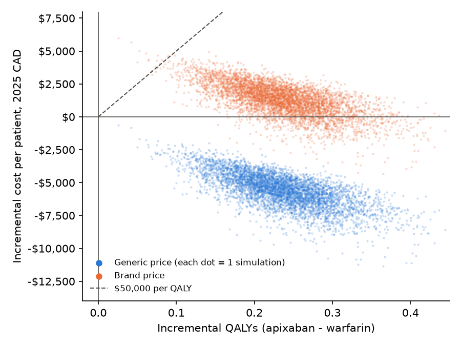
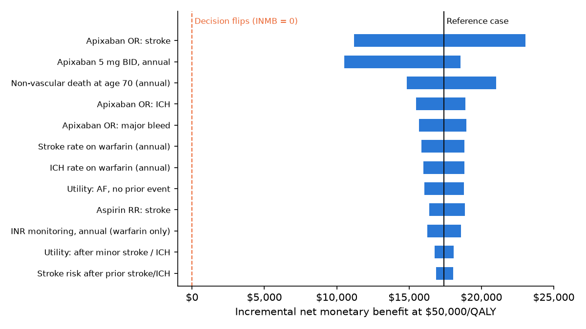

# Generic Apixaban vs Warfarin in Atrial Fibrillation: Cost-Utility and Budget Impact Analysis (Ontario)

**Does generic entry change the economics of stroke prevention?** CADTH judged apixaban good value at about $23,000 per QALY when only the brand was available. Generic apixaban now costs $0.41 per tablet on the Ontario Drug Benefit (ODB) Formulary, 75% below the brand. This project re-runs the analysis at today's prices, following the CADTH reference case.

**Answer:** at current Ontario prices, generic apixaban is **dominant**. It is less costly *and* more effective than warfarin in every analysis performed.

> Independent portfolio project. Not affiliated with, reviewed by, or endorsed by Canada's Drug Agency (CDA-AMC). Developed with AI assistance under author direction; all analytical choices, inputs, and results reviewed and validated by the author.

---

## Key results

| Per patient, lifetime, 2025 CAD | Generic apixaban | Warfarin | Incremental |
|---|---:|---:|---:|
| Total cost (discounted 1.5%) | $22,808 | $28,416 | **−$5,608** |
| QALYs (discounted 1.5%) | 7.464 | 7.228 | **+0.236** |
| Strokes per 1,000 | 238.6 | 281.8 | −43.1 |
| Intracranial haemorrhages per 1,000 | 35.5 | 69.8 | −34.3 |
| **ICER** | | | **Apixaban dominant** |
| Incremental net monetary benefit at $50,000/QALY | | | $17,421 |

- **Probabilistic analysis (5,000 draws):** apixaban was dominant in 100% of simulations. Incremental cost −$5,589 (95% CI −$8,352 to −$3,242).
- **Price thresholds:** apixaban stays cost-saving up to **$1.41/tablet** (3.4× today's price) and cost-effective at $50,000/QALY up to $3.51/tablet. At the brand price the ICER is $5,419/QALY.
- **Robustness:** apixaban stays dominant in all 10 scenarios, including every apixaban odds ratio set to the upper bound of its 95% CI. No one-way sensitivity analysis pushes the INMB below $10,533.
- **Budget impact (Ontario, 65+, 3 years):** switching the remaining warfarin users costs the **drug plan +$6.0M** but saves the **health system −$11.3M**, mainly through avoided strokes and long-term care.

<p align="center">
  
  
</p>

---

## Methods at a glance

| | |
|---|---|
| **Model** | Cohort Markov model, 5 health states, 3-month cycles, age 70 to 100 |
| **States** | AF on anticoagulant · after minor stroke / ICH · after major stroke · after major bleed · dead |
| **Population** | Non-valvular AF, CHADS₂ = 2, age 70 (age-80 scenario) |
| **Perspective** | Publicly funded health care payer (Ontario) |
| **Discounting** | 1.5% per year on costs and QALYs (CADTH 4th ed. reference case) |
| **Inputs** | CADTH 2017 guidelines worked example (RE-LY event rates, CADTH network meta-analysis odds ratios, utilities, event costs). Costs inflated 2011 → 2025 with the CPI (×1.3695). Drug prices from the ODB Formulary, Oct 2026. Background mortality from the Statistics Canada 2021–2023 life table. |
| **Uncertainty** | PSA (beta / lognormal / gamma / normal), one-way analysis (50 parameters), 10 scenarios, exact price-threshold analysis |
| **Validation** | Cross-validated against the CADTH worked example at 2011 prices (costs and life-years within 2%); internal validity checks; mass balance in every cycle |

### Validation against CADTH (2011 prices, brand apixaban)

| | CADTH (2017) | This model | Difference |
|---|---:|---:|---:|
| Incremental cost | $4,107 | $4,044 | −1.5% |
| Incremental QALYs | 0.180 | 0.236 | +31% |
| ICER | $22,875 | $17,117 | −25% |

The simplified 5-state structure, compared with CADTH's 173 states, reproduces costs and survival closely but somewhat overstates the QALY gain. The pessimistic treatment-effect scenarios address this, and the conclusion holds.

---

## Repository structure

```
doac-cua-ontario/
├── notebooks/
│   ├── markov_model.py          # the model engine (imported by every notebook)
│   ├── 01_inputs.ipynb          # parameters, sources, CPI inflation, life-table fit
│   ├── 02_markov_engine.ipynb   # building the model step by step
│   ├── 03_validation.ipynb      # CADTH reproduction and internal validity checks
│   ├── 04_reference_case.ipynb  # base-case results and price thresholds
│   ├── 05_psa.ipynb             # probabilistic analysis, CE plane, CEAC
│   ├── 06_sensitivity.ipynb     # one-way (tornado) and scenario analyses
│   └── 07_cma_bia.ipynb         # cost comparison and Ontario budget impact
├── outputs/                     # inputs.csv, settings.json, result tables, figures
├── excel/
│   └── DOAC_CUA_Ontario_model.xlsx   # transparent Excel version (live formulas)
├── report/
│   ├── doac_cua_report.pdf      # full technical report
│   ├── doac_cua_report.tex
│   └── figures/
├── environment.yml
└── README.md
```

## Excel model

`excel/DOAC_CUA_Ontario_model.xlsx` rebuilds the deterministic model in Excel, following CDA-AMC submission conventions:

- **Every input in one labelled cell** with a named range (`p_stroke`, `or_apx_ich`, …), so formulas read like the model equations
- **Full Markov traces**: every transition is visible in its own column for 120 cycles per arm
- **Matches Python to the cent.** The Validation sheet shows live PASS checks for mass balance and for the Excel-vs-Python results
- **No `IFERROR`** anywhere, so errors are never hidden
- **Levers to try:** set `apx_price_tab` to 1.6336 (brand price), `val_mode` to 1 (reproduces CADTH at 2011 prices), or `share_warf` on the BIA sheet

The PSA and one-way sensitivity analysis run in Python. Their results are on the `Scenarios_PSA` sheet.

## How to reproduce

```bash
conda env create -f environment.yml
conda activate health_econ
cd notebooks
jupyter notebook
```

Run notebooks `01` to `07` in order. Each one reads `outputs/inputs.csv` and `outputs/settings.json` and writes its tables and figures to `outputs/`. The PSA uses a fixed seed (2026), so results reproduce exactly.

## Limitations

- 5-state structure (no history of TIA, MI or pulmonary embolism); see validation above
- Treatment effects from the 2012 CADTH network meta-analysis; utilities and event costs from studies published 1996–2012
- Single risk subgroup (CHADS₂ = 2); no discontinuation or adherence modelling
- Warfarin tablet price is the 2011 ODB value (a small share of total cost)
- Rivaroxaban and dabigatran not modelled (current ODB prices not verified)
- Budget-impact inputs for treatment rates, the share of patients still on warfarin, and uptake are assumptions, tested in sensitivity analysis

## Key references

- CADTH. *Guidelines for the Economic Evaluation of Health Technologies: Canada*, 4th ed., 2017, and its worked example on DOACs vs warfarin
- Coyle D, et al. Cost-effectiveness of new oral anticoagulants compared with warfarin in preventing stroke and other cardiovascular events in patients with atrial fibrillation. *Value Health* 2013;16:498–506
- Granger CB, et al. Apixaban versus warfarin in patients with atrial fibrillation (ARISTOTLE). *N Engl J Med* 2011;365:981–92
- Ontario Ministry of Health. Ontario Drug Benefit Formulary, accessed October 2026

Full reference list in the [report](report/doac_cua_report.pdf).

---

**Daniel Pazos Cordero** · M.Sc. Applied Economics (Banking and Financial Markets), University of Bath · Ottawa, ON
